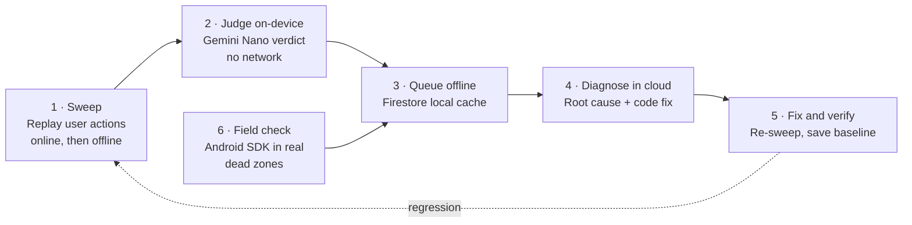
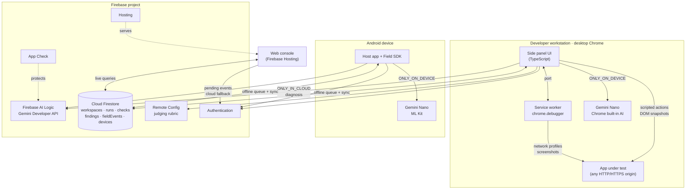
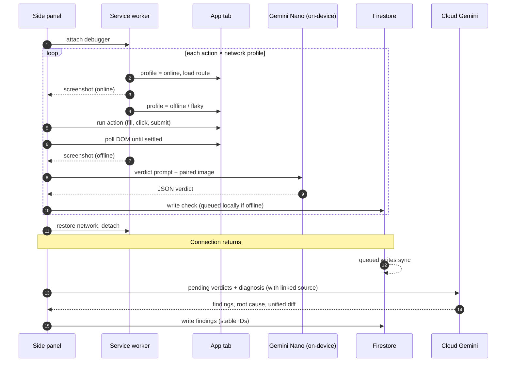

<div align="center">

# Deadzone

**Find the bugs that only happen offline.**

An offline-state auditor for web and Android apps. Deadzone cuts the network on every screen of your app, judges what users actually see with **on-device Gemini Nano**, and uses **cloud Gemini** to explain the root cause and write the fix — built on **Firebase AI Logic hybrid inference**.

[](LICENSE)


[Live console](https://fbailogic26vrt-3003.web.app) · [Extension download](releases/deadzone-extension-0.2.0.zip) · [Demo app (buggy)](https://dz-3003-buggy.web.app) · [Demo app (fixed)](https://dz-3003-fixed.web.app) · [Workspace preview](https://fbailogic26vrt-3003.web.app/preview)

</div>

---

## Table of contents

- [Overview](#overview)
- [How it works](#how-it-works)
- [Architecture](#architecture)
- [Hybrid inference design](#hybrid-inference-design)
- [Features](#features)
- [Repository structure](#repository-structure)
- [Getting started](#getting-started)
- [Testing](#testing)
- [Security and privacy](#security-and-privacy)
- [Project status](#project-status)
- [Roadmap](#roadmap)
- [License](#license)

---

## Overview

Applications are tested on fast office Wi-Fi, but people use them in lifts, basements and trains. When the connection drops, common failures reach customers:

| Failure | What the user experiences |
|---|---|
| Infinite spinner | "Place order" spins forever with no message |
| Data loss | The address they typed is gone when the signal returns |
| Raw error | A technical message such as `TypeError: Failed to fetch` |
| Blank screen | No cached content and no explanation |
| Silent failure | The app looks successful, but nothing was saved |

These states are hard to test: offline testing is manual, and a cloud AI cannot judge a screen while the network is switched off. Deadzone solves this with **hybrid inference** — Gemini Nano evaluates each screen on the device while offline, and cloud Gemini performs diagnosis once the connection returns.

## How it works



1. **Sweep** — the Chrome extension loads each route online, then repeats the user action under an *offline* or *flaky* network profile using the Chrome debugger protocol.
2. **Judge on-device** — deterministic signals (spinner duration, visible text, lost form values) plus Gemini Nano compare the online and offline screenshots and return a schema-validated verdict.
3. **Queue offline** — checks are written to Firestore with persistent local cache and synchronised automatically on reconnect.
4. **Diagnose in the cloud** — cloud Gemini judges any pending checks, groups failures by root cause and, with linked source files, produces a unified-diff fix.
5. **Fix and verify** — after applying the patch, a re-sweep confirms every screen passes; a passing run becomes the baseline and later failures are flagged as regressions.
6. **Field check** — the Android Field SDK detects real connectivity loss, captures the screen and judges it on the phone.

Each sweep produces an **offline score**: the percentage of checks that handle the offline state correctly.

## Architecture



### Sweep sequence



### Components

| Component | Location | Technology | Responsibility |
|---|---|---|---|
| Chrome extension | `apps/extension` | TypeScript, Manifest V3, Vite | Sweeps, on-device verdicts, diagnosis, baselines |
| Web console | `apps/console` | TypeScript, Vite, Firebase Hosting | Workspace dashboards, findings, field events, coverage, pairing |
| Shared library | `packages/shared` | TypeScript, Firebase JS SDK, zod | Firebase initialisation, audit pipeline, schemas, sync |
| Field SDK | `android/deadzone-field` | Kotlin, Firebase AI Logic (hybrid) | Connectivity monitoring, on-device verdicts, field events |
| Demo app | `apps/freshcart` | TypeScript, Vite | Reference app with *buggy* and *fixed* offline behaviour |
| Security rules | `firestore.rules` | Firestore rules | Membership, pairing expiry, document validation |

## Hybrid inference design

Every model call uses a deliberate Firebase AI Logic inference mode:

| Task | Mode | Model | Rationale |
|---|---|---|---|
| Screen verdict during a sweep | `ONLY_ON_DEVICE` | Gemini Nano (image + text) | The app under test is offline; the call must never require the network |
| Pending verdicts and root-cause diagnosis | `ONLY_IN_CLOUD` | Gemini (configurable) | Long context, linked source files, stronger reasoning |
| Plain-language finding explanations | `PREFER_ON_DEVICE` | Nano with cloud fallback | Runs locally when available, falls back automatically |

**Reliability principles**

- **Structured output** — one JSON Schema drives both `responseConstraint` (on-device) and `responseJsonSchema` (cloud); responses are validated again with zod.
- **Deterministic guardrails** — measured signals override the model: lost form values always yield `data_loss`, and a spinner past the timeout yields `infinite_spinner`. Severity is assigned by the rubric, never by the model.
- **Fail safe** — a failed or malformed verdict becomes `pending`, never a pass; pending checks are judged in the cloud after reconnecting.
- **Remote configuration** — spinner timeout, settle time, maximum checks, cloud model and prompt version are served by Remote Config with bounded defaults.

## Features

- **Automated offline sweeps** for any web app, driven by a JSON plan of user actions (navigate, fill, click, submit, wait).
- **Offline and flaky network profiles** in a single sweep.
- **Side-panel workflow**: setup, sweep, results, finding detail with before/after comparison and diff viewer, settings.
- **Findings with stable identities** that move to *fixed* or *regressed* automatically across runs.
- **Baselines and regression detection** shared through the team workspace.
- **Team console**: offline score trend, run reports with filters, findings, Android field events, on-device coverage, QR pairing.
- **Android Field SDK** for real-world dead zones, with cloud judging of pending events after reconnect.

## Repository structure

```
deadzone/
├── apps/
│   ├── extension/          Chrome MV3 extension (side panel, service worker, page automation)
│   ├── console/            Web console and public home page
│   ├── freshcart/          Demo app with buggy and fixed builds
│   └── spike/              On-device inference check page (development tool)
├── packages/
│   └── shared/             Firebase setup, audit pipeline, schemas, Firestore sync
├── android/
│   ├── deadzone-field/     Field SDK library
│   └── app/                Demo host app
├── scripts/                Build helpers and test runners
├── tests/                  Playwright browser tests
├── firestore.rules         Security rules
├── remoteconfig.template.json
└── firebase.json           Hosting, headers and emulator configuration
```

## Getting started

### Prerequisites

- Node.js 22+ and pnpm (`corepack enable`)
- Desktop Chrome 139+ with built-in AI (Gemini Nano) available
- Java 21 for the Firestore emulator tests
- A Firebase project with **Firebase AI Logic** (Gemini Developer API), **Cloud Firestore**, **Authentication** (Google and Anonymous providers), **Remote Config**, **App Check** and **Hosting**

### 1. Install

```bash
pnpm install
```

### 2. Configure Firebase

Copy `.env.example` to `.env.local` in each app you build (`apps/extension`, `apps/console`, `apps/freshcart`) and fill in your Firebase web configuration and reCAPTCHA Enterprise site key. These files are git-ignored.

Deploy the security rules and, optionally, import `remoteconfig.template.json` in the Firebase console:

```bash
firebase deploy --only firestore:rules
```

### 3. Build

```bash
pnpm build        # typecheck and build the extension, console and both demo variants
```

### 4. Load the Chrome extension

A prebuilt evaluation build is included: **[releases/deadzone-extension-0.2.0.zip](releases/deadzone-extension-0.2.0.zip)** (download and unzip it), or use your own build in `apps/extension/dist`.

1. Open `chrome://extensions` and enable **Developer mode**.
2. Click **Load unpacked** and select the unzipped folder (or `apps/extension/dist`).
3. Open the side panel. On **Setup**, download the on-device model if prompted, and register the App Check debug token printed in the panel's DevTools console (Firebase console → App Check → Manage debug tokens).

### 5. Run a sweep

1. Open the demo app (`https://dz-3003-buggy.web.app`) or your own app in the active tab.
2. On **Sweep**, review the plan and click **Start sweep**. Optionally disconnect the network first.
3. On **Results**, reconnect and select **Diagnose in cloud**. Link the app's source folder to receive a code fix.

### 6. Pair a workspace (optional)

Sign in to the console, open **Settings** and generate a pairing code (valid for 15 minutes). Enter the workspace ID and code in the extension's Setup tab or scan the QR code with the Android app.

### Android

See [android/README.md](android/README.md) for building the Field SDK and demo app.

## Testing

```bash
pnpm check:encoding   # source encoding check
pnpm format:check     # Prettier
pnpm lint             # ESLint
pnpm typecheck        # strict TypeScript, per package
pnpm test             # audit pipeline unit tests
pnpm test:rules       # Firestore rules and offline sync (emulator)
pnpm test:browser     # demo app offline behaviour (Playwright)
pnpm test:extension   # loads the built extension in Chromium
```

All checks run in continuous integration (`.github/workflows/check.yml`).

## Security and privacy

- **App Check** protects every Firebase AI Logic request.
- **On-device evaluation**: screenshots are judged locally; only results, and source files you explicitly approve, are sent to the cloud.
- **Least-privilege site access**: the extension requests permission per origin, only when a sweep starts, and always restores the network state afterwards.
- **Firestore rules** enforce workspace membership, 15-minute pairing codes, and type, enum and size validation for every document.
- **No secrets in the repository**: Firebase web configuration lives in git-ignored `.env.local` files; demo data is fictional.

Debug App Check providers are used for development and evaluation builds only and must not be shipped to production.

## Project status

| Area | Status |
|---|---|
| Chrome extension, console, shared library, demo app | Implemented and tested |
| Firestore rules and offline synchronisation | Emulator-tested |
| On-device verdict quality on real hardware | Requires Chrome with Gemini Nano available |
| Android Field SDK | Implemented; device build and verification pending |

## Roadmap

- Run sweeps in CI so offline regressions block pull requests
- Open pull requests with generated fixes
- Additional field signals: slow networks and captive portals
- Rate-limited server-side pairing and error telemetry

## License

Distributed under the [Apache License 2.0](LICENSE).
